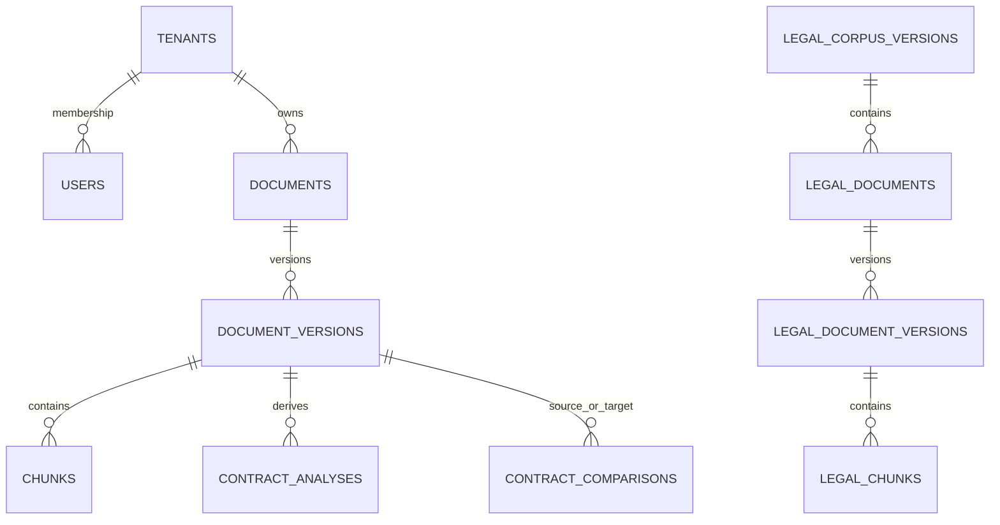

# Database deep dive

## Entities and writers/readers

| Table | Purpose | Writers | Readers |
|---|---|---|---|
| `tenants` | tenant identity | bootstrap/admin | auth and scoped services |
| `users` | user/password state | bootstrap/admin | auth |
| `tenant_memberships` | user-role boundary | bootstrap/admin | auth/RBAC |
| `documents` | logical immutable document | ingestion | document/UI |
| `document_versions` | uploaded content/version lifecycle | ingestion | processing/indexing/contract services |
| `chunks` | processed searchable units plus vector | indexing | retrieval/analysis |
| `contract_analyses` | derived version/config snapshot | contract service | API/agent/comparison |
| `contract_comparisons` | derived pair snapshot | comparison service | API/agent/UI |
| `legal_corpus_versions` | legal release boundary | legal ingestion | legal retrieval |
| `legal_documents` | legal source identity | legal ingestion | legal retrieval |
| `legal_document_versions` | immutable legal source version | legal ingestion | legal retrieval |
| `legal_chunks` | legal text/vector units | legal ingestion | legal retrieval |

There are no conversation, agent-run, cache, or evaluation-result tables in the
current models/migrations.

## ORM and constraints

`app/models/*.py` subclasses `app.db.base.Base`. UUID primary keys avoid central
integer coordination. Foreign keys, unique version/checksum constraints,
status checks, tenant/version indexes, and composite foreign keys protect
identity and lifecycle. `DocumentVersion` is immutable in content: changed
content creates a version; duplicate checksum is rejected.

`Chunk` has a `Vector` column using the configured 384 dimensions, JSON source
block provenance, content/logical hashes, and an HNSW cosine index. Legal chunks
have a separate vector table so contract and law evidence cannot be mixed.

## Sessions and transactions

`ResourceManager` creates an async SQLAlchemy engine with `pool_pre_ping` and an
`async_sessionmaker`. Request dependencies yield a session. Ingestion/indexing
commit state transitions and rollback on failure; derived analyses/comparisons
use uniqueness/configuration keys for idempotent replacement. Alembic migrations
are the schema history, currently `0001` through `0008`.

## ER sketch

## Vector query

`RetrievalService.dense()` applies tenant/document/version predicates first,
orders by `Chunk.embedding.cosine_distance(query_vector)`, and limits the
candidate request. Authorization is therefore part of the SQL search boundary,
not a post-processing hope.
